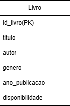

# 📘 Relatório do Projeto - Acervo de livros 

Este projeto é uma aplicação web completa (Full Stack) desenvolvida com **Flask (backend)** e **Next.js (frontend)**.  
O objetivo é gerenciar um acervo de livros — permitindo cadastrar, visualizar, atualizar e remover obras — de forma simples e intuitiva.

---

## 🎯 Propósito e Ideia Geral
A aplicação foi criada com o intuito de facilitar o **cadastro e gerenciamento de livros** em um acervo digital pessoal.

A ideia central é permitir que o usuáio:
- 📚 Cadastre livros com o título, autor, ano de publicação e gênero; 
- 👀 Visualize seu acervo pessoal;  
- ✏️ Atualize informações de um livro;  
- ❌ Remova livros do sistema.

Esta aplicação se destina a:
- **Usuários**, que desejam organizar e gerenciar seu próprio acervo de leitura.

---

## ⚙️ Stack e Tecnologias Utilizadas

### **Backend (API REST)**:
- [Python 3.10+](https://www.python.org/)
- [Flask](https://flask.palletsprojects.com/)
- [Flask-SQLAlchemy](https://flask-sqlalchemy.palletsprojects.com/)
- [Flasgger](https://github.com/flasgger/flasgger) → para documentação Swagger da API
- [Flask-CORS](https://flask-cors.readthedocs.io/en/latest/) → para permitir acesso do frontend

### **Banco de Dados**:
- [SQLite](https://www.sqlite.org/) (pode ser substituído por MySQL ou PostgreSQL)

### **Frontend (Interface Web)**:
- [Next.js 13+](https://nextjs.org/)
- [React](https://react.dev/)
- [Tailwind CSS](https://tailwindcss.com/)
- [Fetch API / Axios](https://axios-http.com/) → para consumir a API

### **Controle de Versão**:
- [Git](https://git-scm.com/) e [GitHub](https://github.com/)


---

## 🚀 Instruções para Rodar Localmente

### 🔧 Pré-requisitos:
- **Python 3.10+** (para o backend Flask)  
- **Node.js 18+** (para o frontend Next.js)  
- **npm** (gerenciador de pacotes Node)

---


### 🖥️ Como rodar localmente:

###1. Clone o repositório:

```bash
git clone https://github.com/VictorAMJ/seu-repo.git
cd seu-repo
```
   
###2. Configurar o script de inicialização conjunta:
No arquivo AP2-Frontend/package.json conforme os seguintes scripts:

```bash
  "scripts": {
  "dev": "concurrently \"npm run backend\" \"next dev\"",
  "backend": "cd ../backend && python app.py"
}
```

###3. Iniciar a aplicação completa:
Ainda dentro da pasta AP2-Frontend, rode no terminal:

```bash
npm run dev
```

Isso irá:
- Iniciar automaticamente o servidor Flask(API) na porta 5000
- Iniciar o Next.js na porta 3000

🌐 Endereços de acesso:

📍 Frontend (interface web): `http://localhost:3000`
📍 Backend (API Flask): `http://127.0.0.1:5000`
📍 Documentação Swagger (API): `http://127.0.0.1:5000/apidocs`

📝 **Observação:** O banco de dados é criado automaticamente na primeira execução.


---


## 🗂️ Diagrama ER:
O modelo de dados da aplicação foi estruturado conforme o diagrama abaixo:



> O diagrama foi criado no Draw.io.


---


## 🧑‍💻 Autores

- Gabriela Araujo Rodrigues _ RA: 2400466
- Victor Alexandre Martuzzo de Jesus _ RA: 2400690
